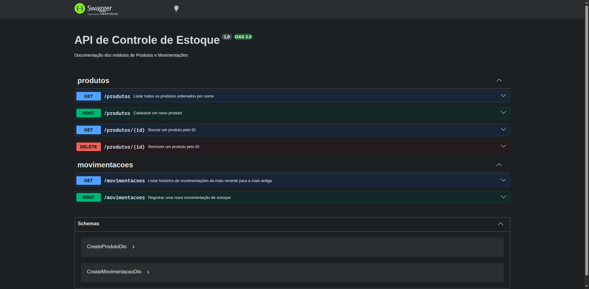
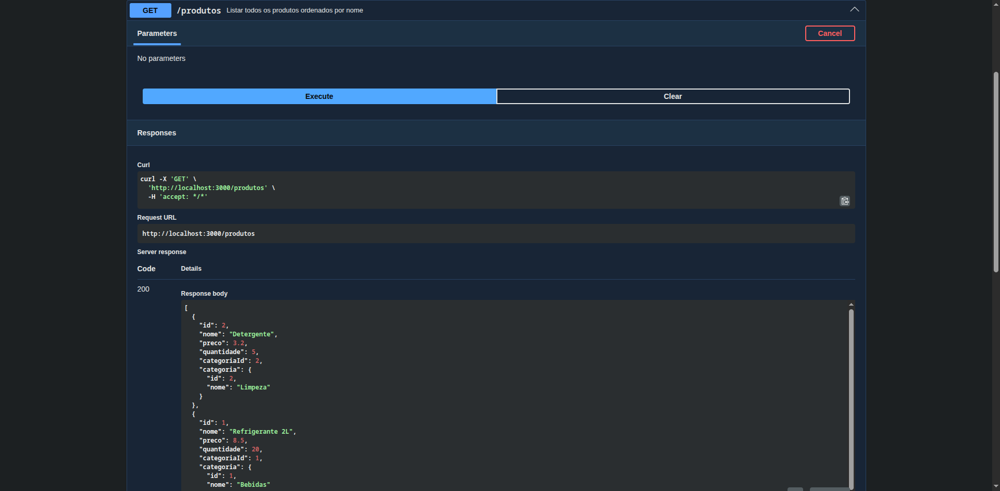
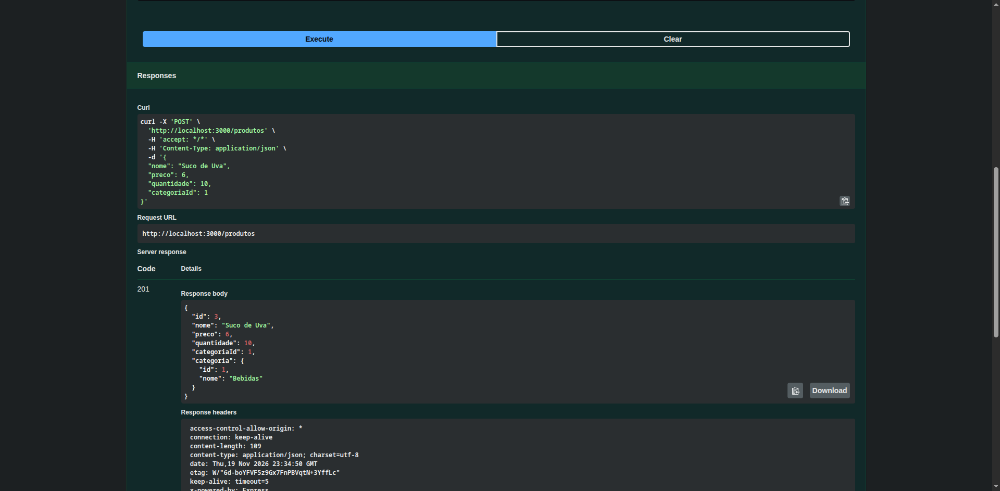
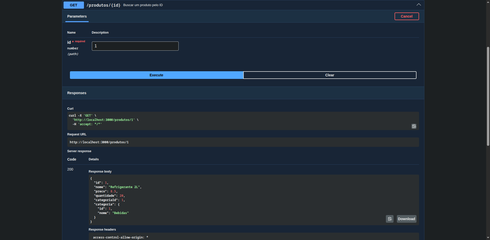
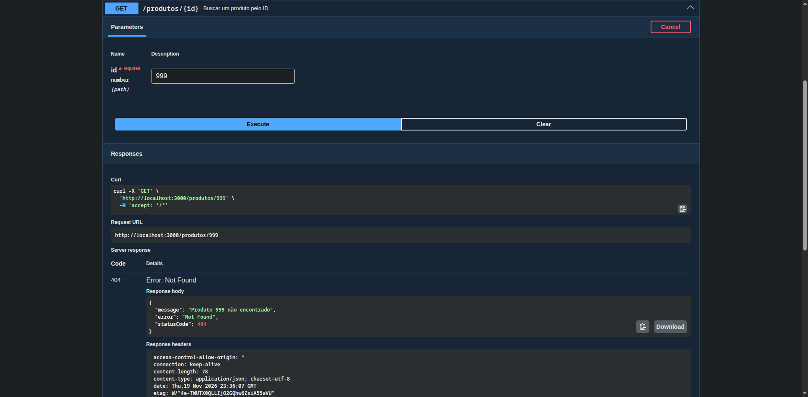
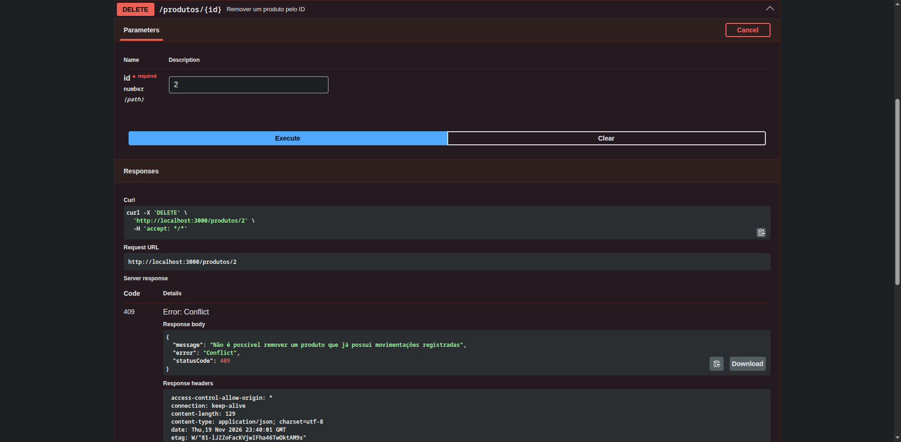
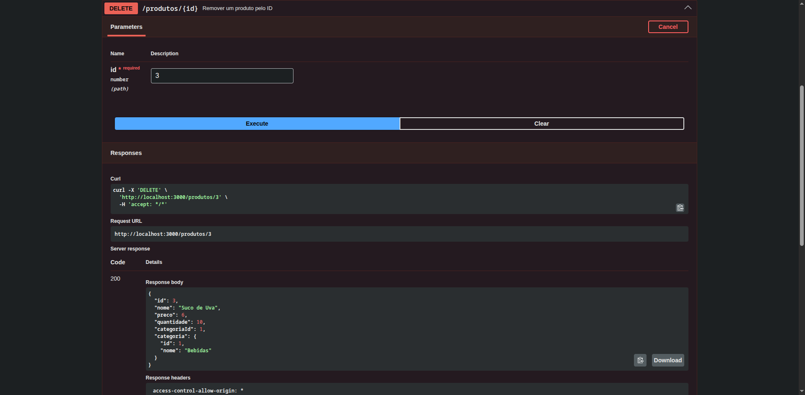
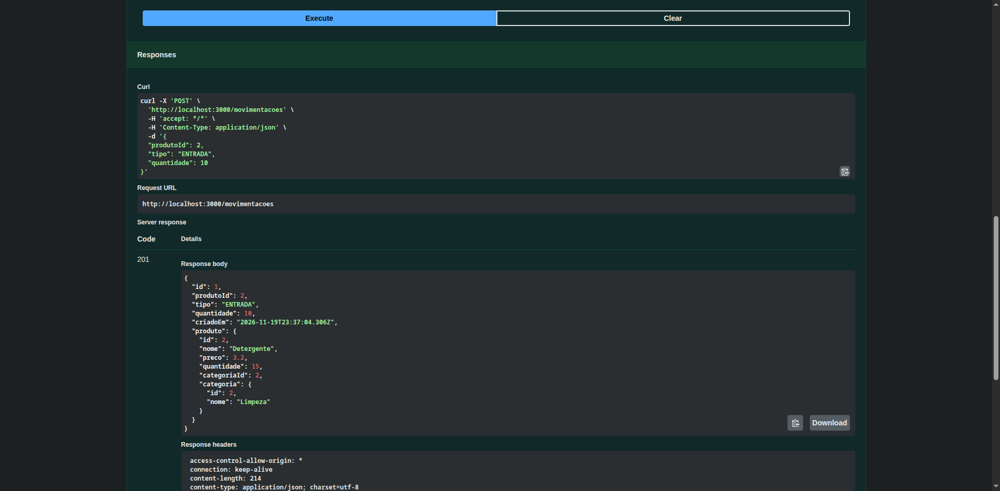
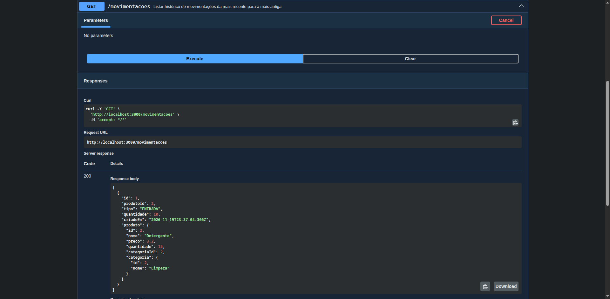
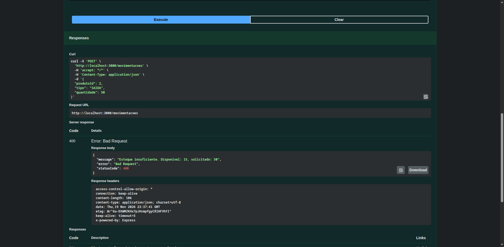

# Controle de Estoque — Atividade 01 e 02 (Produtos e Movimentações)

Implementação dos módulos de **Produtos** (`src/produtos`) e **Movimentações** (`src/movimentacoes`) no backend NestJS + Prisma.

## Como executar

1. Subir o banco PostgreSQL:
   ```bash
   docker compose up -d
   ```
2. Configurar e iniciar o backend:
   ```bash
   cd backend
   npm install
   npx prisma migrate dev
   npx prisma db seed
   npm run start:dev
   ```
3. Documentação Swagger disponível em: `http://localhost:3000/api`

---

## Rotas Implementadas e Execuções (Prints)

### Documentação Swagger (`/api`)


---

### Módulo de Produtos (`produtos`)

#### 1. `GET /produtos` — Listar produtos ordenados por nome com categoria (`200 OK`)


#### 2. `POST /produtos` — Cadastrar novo produto (`201 Created`)


#### 3. `GET /produtos/:id` — Buscar produto por ID (`200 OK`)


#### 4. `GET /produtos/:id` (Caso de Erro) — Produto inexistente (`404 Not Found`)


#### 5. `DELETE /produtos/:id` (Caso de Erro) — Produto com movimentações (`409 Conflict`)


#### 6. `DELETE /produtos/:id` — Remover produto sem movimentações (`200 OK`)


---

### Módulo de Movimentações (`movimentacoes`)

#### 1. `POST /movimentacoes` — Registrar movimentação de entrada/saída (`201 Created`)


#### 2. `GET /movimentacoes` — Listar histórico do mais recente para o mais antigo (`200 OK`)


#### 3. `POST /movimentacoes` (Caso de Erro) — Saída maior que o estoque disponível (`400 Bad Request`)

